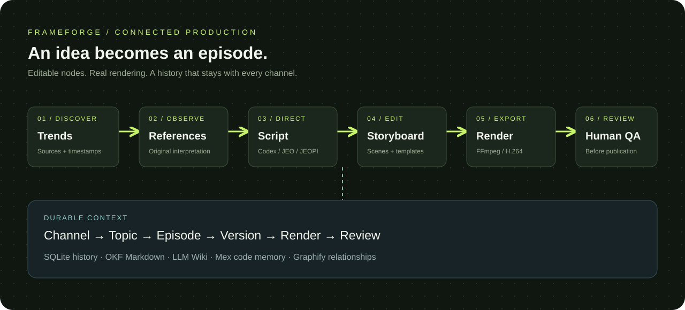
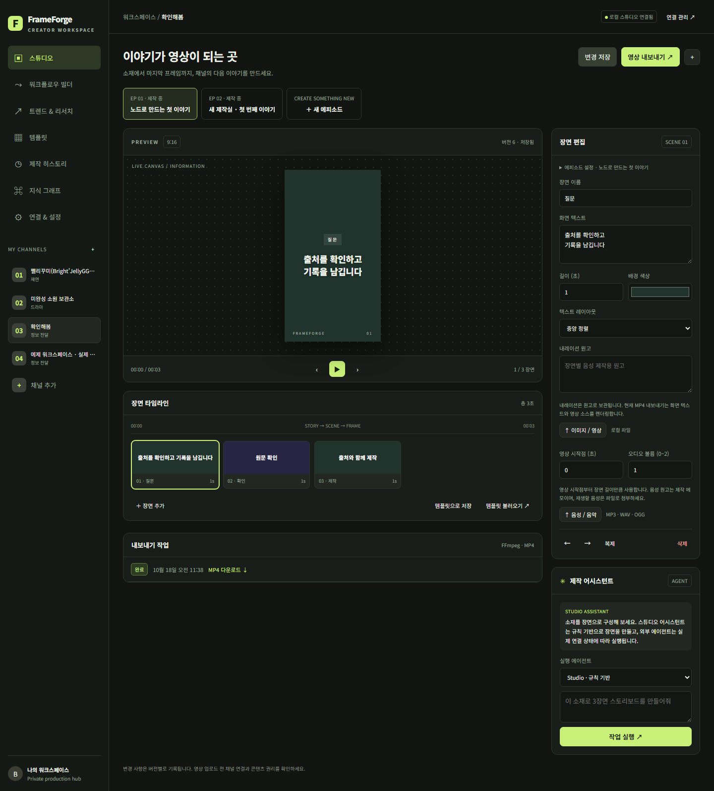
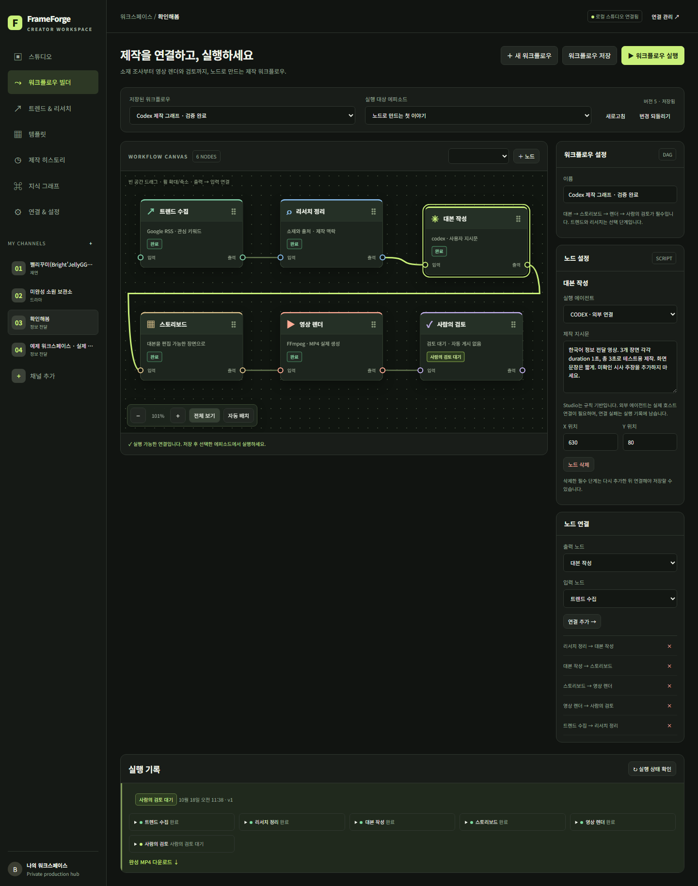
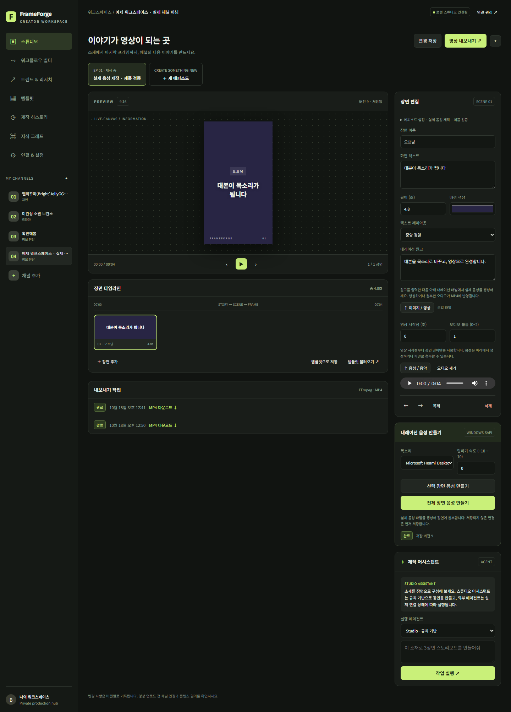
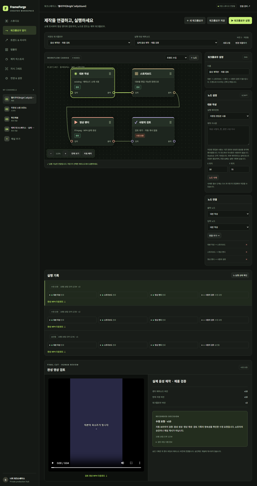
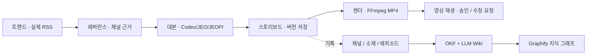
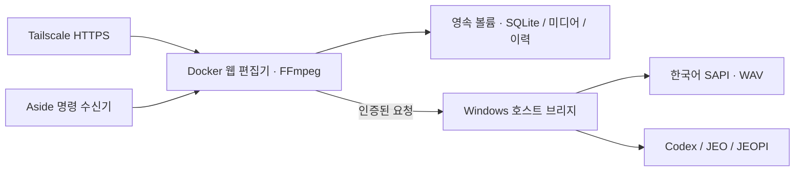
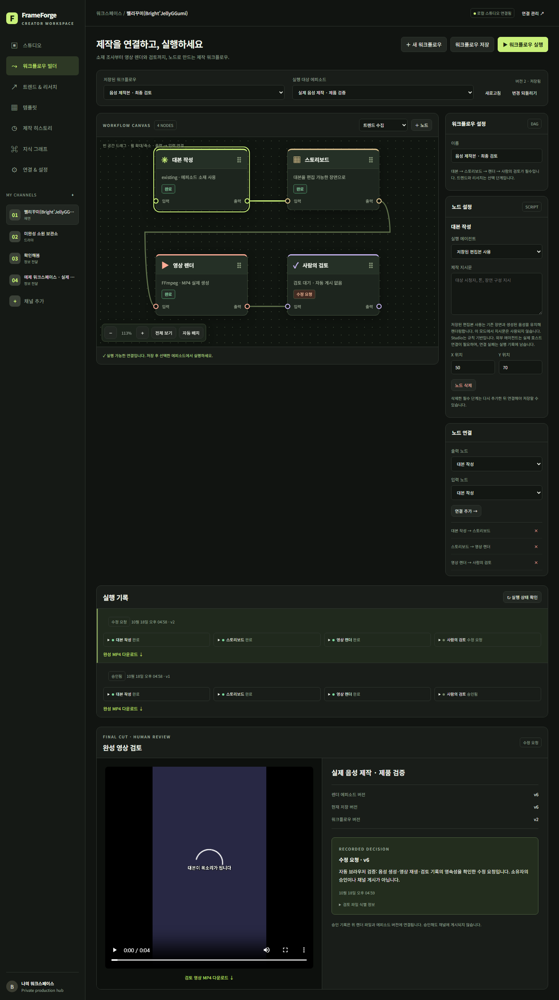

# FrameForge Studio

채널의 소재 조사부터 연출, 장면 편집, MP4 출력과 검토까지 연결하는 개인 영상 제작 허브입니다. 드라마·재연·정보 전달용 템플릿을 수정하고, **ComfyUI에서 참고한 노드 연결 방식**으로 제작 순서를 구성합니다. 실행 워크플로우와 장기 지식 그래프는 서로 다른 화면과 데이터로 관리합니다.



**운영 URL:** [Tailscale 개인 제작실](https://desktop-qrf3t5t.taila2003e.ts.net/) · 같은 tailnet에 연결된 기기에서 접근 토큰으로 로그인합니다. 인터넷 공개 Funnel은 켜지 않았습니다.





위 이미지는 운영 서비스에서 직접 캡처했습니다. [모바일 화면](docs/assets/workflow-mobile.png)과 [브라우저 검증 기록](artifacts/browser-smoke.json)도 제공합니다.





[음성·영상 검토의 모바일 화면](docs/assets/review-mobile.png) · [실제 재생·검토 저장 검증](artifacts/production-browser-smoke.json)

## 실제로 할 수 있는 작업

- 채널을 등록하고 소재·에피소드·수정 버전·렌더링 결과를 연결합니다. 현재 운영 데이터에는 Aside에서 확인한 세 채널을 등록했습니다. 새 설치에는 명확히 표시된 예제 채널만 생성합니다.
- 장면을 추가·복제·재정렬하고 화면 문구, 배경, 길이, 9:16·16:9·1:1 포맷과 레이아웃을 수정합니다. 이미지·영상을 업로드하고 영상 시작점, 장면별 음성·음악과 볼륨을 조절합니다.
- 편집 결과를 재사용 템플릿으로 저장합니다. FFmpeg가 한국어 자막을 포함한 H.264/AAC MP4를 생성하며 인증된 다운로드와 작업 이력을 제공합니다.
- Windows에 설치된 한국어 음성으로 장면별 내레이션을 생성하고 미리 듣습니다. 음성 길이에 맞춰 장면을 늘리고, 저장된 편집본과 음성을 그대로 워크플로우에서 렌더링합니다.
- 완성 MP4를 웹에서 재생하고 승인 또는 수정 요청을 기록합니다. 결정은 에피소드 버전·렌더 작업·파일 SHA-256에 연결되며, 변경된 편집본은 다시 렌더해야 검토할 수 있습니다.
- Google Trends KR RSS에서 실제 소재를 수집합니다. Naver DataLab과 공식 크리에이터 레퍼런스는 출처·조사일·관찰 메모와 함께 기록합니다. [조사 근거와 템플릿 제안](docs/research-playbook.md)을 제공합니다.
- 웹 채팅에서 Codex·JEO·JEOPI가 작성한 스토리보드를 검증한 뒤 에피소드 버전으로 적용합니다. `Studio`는 규칙 기반 도우미이며 외부 LLM과 구분해 표시합니다.
- Aside 지정 세션의 명령을 영속 명령함으로 가져옵니다. 웹 명령함 접수는 기록이며, 실행은 에이전트 채팅 또는 워크플로우에서 명시적으로 시작합니다.

## 연결해서 실행하는 제작 흐름



노드를 이동하고 입·출력 포트를 연결하거나 연결 폼을 사용합니다. 확대·축소, 전체 보기, 자동 배치, 노드 설정, 저장·불러오기, 실행·취소와 노드별 실행 결과를 제공합니다. 저장 시 순환, 잘못된 포트, 끊어진 필수 경로를 거부합니다.

현재 실행기는 `trend`, `research` 선택 노드와 `script → storyboard → render → review` 필수 노드로 구성됩니다. 각 종류는 한 번씩 사용하며 4–6개 노드를 지원합니다. 범용 ComfyUI 플러그인 런타임이나 무제한 모델 그래프가 아닙니다. `script`에서 에이전트와 연출 프롬프트 또는 **저장된 편집본 사용**을 선택합니다. 완료된 MP4는 `awaiting_review`로 멈추고 웹 검토 후 `approved` 또는 `changes_requested`로 기록됩니다. 승인해도 자동 공개되지 않습니다. 실행 시 워크플로우와 에피소드 스냅샷을 저장하고, 수정 충돌·실패·중단을 기록합니다.

## 실행

Node 22.13 이상, FFmpeg/ffprobe와 한국어 폰트가 필요합니다. npm 런타임 의존성은 없습니다. 개발 기본 주소는 `127.0.0.1:4310`입니다.

내레이션 생성은 Windows SAPI의 설치된 목소리를 사용합니다. Linux Docker도 인증된 호스트 브리지로 한국어 WAV를 받아 장면에 연결합니다. 실제 Docker → Windows 음성 → 1080×1920 MP4 제작과 브라우저 재생을 확인했습니다. 브리지가 없으면 제공자 실패를 명시하며, 업로드한 음성의 편집·렌더도 지원합니다.

```powershell
node scripts/configure.mjs
node --env-file=.env server/app.mjs
```

`configure`는 `.env`에 접근 토큰과 별도 브리지 토큰을 생성하고 기존 설정은 보존합니다. 접근 토큰은 로컬 `.env`의 `LOGIN_TOKEN` 값입니다. 파일은 Git에서 제외됩니다. Windows에서 서버·브리지·Aside 수신기를 숨김 창으로 지속 실행하려면 다음을 사용합니다.

```powershell
powershell -NoProfile -File scripts/start-local.ps1
# 이 프로젝트의 기록된 PID만 종료
powershell -NoProfile -File scripts/stop-local.ps1
```

에이전트 브리지는 호스트에 설치된 인증된 Codex/JEO/JEOPI CLI를 사용합니다. 임의 셸 명령을 받지 않고 텍스트 전용 호출 및 장면 스키마 검증을 수행합니다. JEO 어댑터는 실행 프로세스 안에서 OAuth 모델 목록을 갱신하여 오래된 정적 목록 문제를 처리합니다. 설치 여부와 실제 응답 검증 여부는 구분됩니다. Hermes 기존 하니스는 참고 기록이며 현재 실행 어댑터는 비활성입니다.

## Docker와 Tailscale

```powershell
# 기존 운영 데이터가 이전된 이 PC에서
& .\scripts\start-docker.ps1
# 소스 변경 후 이미지 갱신
& .\scripts\start-docker.ps1 -Build
docker compose -p frameforge-studio ps
```

컨테이너는 비루트 계정, 읽기 전용 루트 파일시스템, `/data` 영속 볼륨, 루프백 포트 바인딩을 사용합니다. FFmpeg와 Noto CJK 폰트를 이미지에 포함합니다. 호스트 실행과 컨테이너 실행은 같은 4310 포트를 사용하므로 전환 전에 기존 서버만 중지합니다. 호스트 `data/`와 Docker 볼륨은 별도 저장소이므로 기존 운영 데이터는 백업 후 명시적으로 옮겨야 합니다.

컨테이너의 에이전트·음성 호출 대상은 `host.docker.internal:4311`입니다. 이 PC의 Docker에서 호스트 루프백 브리지 접근과 실제 Codex 응답을 확인했습니다. `HOST_AGENT_BRIDGE_URL`로 대상만 별도 지정할 수 있습니다. 브리지 토큰은 비공개 환경변수로 공급하며 CLI OAuth 자격증명은 호스트에 유지합니다. [초기 이전·재시작·복구 운영 절차](docs/docker-operations.md)를 제공합니다. 런처는 기존 볼륨과 비어 있지 않은 DB를 확인하여 빈 제작실로 잘못 시작하지 않습니다.

**Docker 실동작 검증:** [GitHub CI 39095384742](https://github.com/akillness/frameforge-studio/actions/runs/39095384742)에서 소스 `c56cc4a`의 58개 테스트, 이미지 빌드, 비루트·읽기 전용 Compose 기동, 인증된 1080×1920 H.264/AAC 렌더링·다운로드와 저장된 편집본의 검토를 통과했습니다. 재시작 후 에피소드·이력·검토 결정·동일 MP4 해시 보존도 확인했습니다. [컨테이너 검증 결과](artifacts/container-smoke.json)를 저장했습니다.

**현재 로컬 배포:** WSL 서비스를 복구한 뒤 Docker 29.5.2로 운영 URL을 전환했습니다. 기존 채널 4개·에피소드 3개·미디어 10개의 ID·버전·해시를 보존했습니다. 한국어 음성, 실제 Codex 대본, MP4 렌더, HTTPS 브라우저 재생·검토와 컨테이너 재시작 보존을 검증했습니다. [이전 근거](artifacts/docker-migration.json), [운영 Docker 근거](artifacts/docker-verification.json), [재시작 근거](artifacts/live-container-smoke.json), [전체 검증 기록](docs/verification.md)을 확인하세요.





[Docker HTTPS 브라우저 검증](artifacts/docker-live-production-browser-smoke.json): 음성·영상 재생, 검토 저장, 1440/390px 화면, 페이지 오류 0.

HTTPS 프록시를 사용할 때 `.env`에 `PUBLIC_ORIGIN=https://서비스주소`를 지정합니다. Compose에도 전달되며 로그인 쿠키에 `Secure`가 적용되고 쓰기 요청의 Origin을 제한합니다.

## 하니스 최신 버전과 아카이브

활성 버전은 `harness/manifest.json`이 가리키는 **1.3.0**입니다. Docker 음성 브리지와 데이터 이전 검증 계약을 반영했고, 이전 **1.0.0·1.1.0·1.2.0** 번들은 `harness/archive/`에 원본 그대로 보존됩니다. 원본 `.claude/agents/`, `.claude/skills/` 및 `docs/harness.md`를 수정한 다음 새 버전을 승격합니다. 보존된 버전 파일은 직접 수정하지 않습니다.

```powershell
node scripts/version-harness.mjs verify
# 다음 계약을 수정한 뒤 새 버전으로 승격
node scripts/version-harness.mjs promote 1.4.0
node scripts/version-harness.mjs rollback 1.3.0
```

SHA-256 검증, 독점 잠금, 원자적 활성 포인터 변경, 중복 버전 거부와 이전 번들 보존을 수행합니다. 외부의 과거 Hermes 제작물은 삭제하거나 저장소로 무단 복사하지 않았습니다. [버전 운영 규칙](docs/harness-versioning.md)을 참고하세요.

## 지속되는 지식

| 저장소 | 책임 |
| --- | --- |
| `data/studio.sqlite` | 채널·소재·에피소드·작업·워크플로우와 버전 기록 |
| `data/knowledge/` | 운영 데이터에서 생성한 OKF Markdown 원자와 관계 그래프 |
| `llm-wiki/raw/` | 수정하지 않는 출처와 해시 |
| `llm-wiki/wiki/` | 근거·개념·설계·검증 기록, index/log |
| `.mex/` | 실제 코드 심볼에 연결한 프로젝트 메모리 |
| `.graphify/` | 코드·문서 관계와 HTML 시각화; 구조 추출과 의미 추론 여부 구분 |
| `harness/versions/`, `harness/archive/` | 재현 가능한 제작 하니스와 이전 계약 |

```powershell
mex graph rebuild --json
mex check
python .graphify/refresh.py
python .mex/verify-knowledge.py
```

## 검증과 현재 경계

```powershell
npm test
npm run check
npm run test:render
node scripts/media-smoke.mjs
node --env-file=.env scripts/workflow-smoke.mjs
node --env-file=.env scripts/production-smoke.mjs
python scripts/production-browser-smoke.py
```

자동 테스트는 인증·CSRF·경로 격리·업로드·버전 충돌·실행 실패·DAG·취소·재시작 복구·하니스 아카이브를 확인합니다. 실제 검증은 MP4 출력/다운로드, 영상 트리밍과 비무음 오디오, Google RSS, 각 에이전트 응답 및 브라우저 편집 흐름을 별도로 기록합니다. 테스트용 주입 렌더러와 실제 FFmpeg 결과를 구분합니다.

Naver의 전체 실시간 순위를 자동 수집한다고 주장하지 않습니다. YouTube 채널 등록과 제작 관리를 지원하며 채널 생성·OAuth 게시 API는 포함하지 않습니다. 게시 전 YouTube Studio에서 검토합니다. 음성은 Windows 로컬 TTS 또는 업로드 자산을 사용합니다. 에이전트 채팅은 스토리보드 작성이며 이미지/배우 영상 생성 서비스의 유료 호출은 연결하지 않았습니다.

장면 편집기의 미리보기는 레이아웃 확인용이며 MP4와 자막 크기가 완전히 일치하지 않습니다. 최종 자막·음성·길이는 완성 영상 검토 플레이어에서 확인합니다.

ECC 2.2.3 활성 설치를 확인했고 실제 코드/검증 작업에 적용했습니다. Jev는 최신 실행기를 별도 캐시에 고정하고 `frameforge-codex` 프로필로 **실제 API 검토**를 실행했습니다. 응답 모델은 `jev-1.13.0`, 결과는 `proposal_only`입니다. 과제 부합성 0.93, 근거 지지 0.80이었으나 두 항목의 확신도가 기준 0.80에 못 미쳤습니다. `unvalidated` 참고 모드이며 자동 훅·권한 부여는 없습니다. [실제 응답과 판단 근거](artifacts/jev-live-review.json), [재현 방법](docs/jev.md)을 제공합니다. API 키는 저장소 밖 비공개 프로필에서만 읽습니다.

Docker 변경에 대해서도 Jev 실제 API 검토를 추가 실행했습니다. 결과는 `proposal_only`이며, [현재 구현 검토 영수증](artifacts/jev-docker-review.json)에 근거와 한계를 보존했습니다. 자동 허가로 취급하지 않고 ECC 독립 리뷰와 실동작 검증을 별도로 완료했습니다.

설계 참고: [ComfyUI 노드](https://docs.comfy.org/development/core-concepts/nodes), [Tailscale Serve](https://tailscale.com/docs/features/tailscale-serve), [Google Trends](https://support.google.com/trends/answer/3076011), [Naver DataLab](https://developers.naver.com/docs/serviceapi/datalab/search/search.md). README SVG는 이 프로젝트를 위해 직접 작성했습니다.
