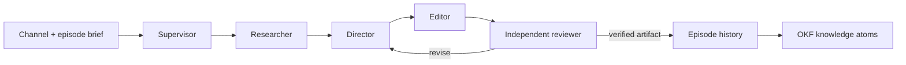

# Production harness

## Editing history and Higgsfield generation

Version 1.4.0 adds readable episode/workflow comparisons, new-version restoration and per-node settings/results/history. Restoring requires the current expectedVersion and preserves every previous snapshot. Draft undo/redo is distinct from persisted versions.

Version 1.6.0 defines the repeated-node, project-owned production and separately approved publication contract below. Immutable 1.5.0 retains its earlier ten-type, 1–10-node, 0–45-edge staging contract unchanged. Resolve `harness/manifest.json` and verify the selected bundle before production work; authoring text alone does not activate a release. Promotion follows the runtime gates in [versioning](harness-versioning.md).

Optional scene-specific `generate` nodes depend on connected storyboard inputs and feed render. They use the selected Higgsfield transport's actual model schema; default graphs omit paid generation. A combined exact-input quote, explicit human disclosure decision and generation consent precede `allowGeneration:true`. Persist each node/scene's original request intent before submission and retain its generation job, provider ID, model, output hash and resulting episode version. Reuse completed jobs after partial failure; uncertain identity blocks replay. Recover the existing provider job and retain paid output when version-bound application conflicts.

Official remote MCP OAuth, Developer API credentials and the logged-in official CLI are distinct. The project MCP uses the authenticated studio API to retain production lineage. Check [connection evidence](higgsfield-integration.md); configured endpoints are not verified provider authentication. No credentials belong in role prompts, graphs, snapshots or Git.

FrameForge uses a supervisor-led pipeline with independent review. Editable file-based roles live in `.claude/agents/`; production consumers first resolve `harness/manifest.json` and read the selected immutable bundle. Codex, jeo and jeopi can read the same contracts through the root `AGENTS.md`. These files define reusable work contracts. They do not prove that every runtime or external provider is connected. See [versioning and rollback](harness-versioning.md).

## Roles and handoffs

| Role | Owns | Required output |
|---|---|---|
| Supervisor | Scope, dependencies, version conflict resolution | Run manifest and summary |
| Researcher | Trend and creator evidence | Source URL, observed time, claim, uncertainty, visual reference notes |
| Director | Original treatment and editable template | Scenes, durations, layout, narration and source bindings |
| Editor | Validated scene changes and local render | New episode version, render receipt and artifact hash |
| Reviewer | Independent content and technical acceptance | Pass/fail findings tied to exact version and artifact |

Each run uses an absolute `<repo>/_workspace/<run-id>/` path resolved by the supervisor. Inputs include `channelId`, `episodeId`, `expectedVersion`, requested format, scope and available source IDs. Preserve `tasks.json`, per-role outputs, `conflicts.md` when needed and `run-summary.md`. These operational files may contain personal information; keep them out of public Git history.

Research can fan out by source only when each agent has a separate output path. Direction depends on completed research; editing depends on direction; review depends on the exact rendered candidate. An editor cannot approve its own render. On conflict, re-read the episode version and merge deliberately; never overwrite a newer version. On a timeout, report the existing job ID before considering a retry. Missing factual, rights or final-render evidence prevents a verified completion claim.

## Runtime boundary

The web chat submits bounded requests through `server/integrations.mjs` to the host bridge. The service validates patches before updating SQLite history. A CLI executable on PATH is availability evidence only; provider authentication and a successful invocation are separate checks. The built-in studio assistant is a deterministic helper, not an LLM. Publishing and channel creation remain separate authenticated platform operations.

## Executable production graph

`server/workflows.mjs` implements a bounded connected DAG with ten supported roles: `trend`, `news`, `research`, `script`, `storyboard`, `layout`, `generate`, `render`, `review` and `publish`. Roles may repeat; unique node IDs identify dependencies, inputs, outputs, retry and history. Accept 1–128 nodes and 0–256 edges under the separate 1 MiB JSON-body limit. Validate unique node/edge IDs and endpoint pairs, known endpoints, finite coordinates, connectivity, self-edges and cycles. Same-role edges are valid when acyclic. A node ID must not shadow a different supported role; optional labels are ≤80 characters and notes ≤2000.

`server/graph.mjs` derives deterministic topological order from actual edges, with lexical node-ID ties, independent of stored node order or role order. Prerequisite resolution traverses every incoming path through intermediate roles, stopping each path at its nearest producer of the requested role. Exactly one distinct boundary producer is required; missing or ambiguous required inputs reject execution. Optional context may be absent, but ambiguity rejects it. Repeated same-role chains bind the nearest producer: `render1 → review1 → render2 → review2` binds `review2` to `render2`. No consumer chooses the first role in the workflow. Structural validation uses this resolver for connectivity; runtime selection additionally rejects ambiguous producers with 409.

Each storyboard requires its connected script; layout/generate require a connected storyboard and must feed a render; review requires its connected render; publish requires the matching connected review/render branch. Render combines relevant upstream generation outputs by node/scene identity. Single-node definitions may be saved where validation permits, but saving a graph does not waive runtime prerequisites. This is the production graph, not an arbitrary model-workflow loader.

| Stage | Actual responsibility and configuration |
|---|---|
| Trend | Fetch source-backed keyword observations; `query` ≤200; empty results fail the node |
| News | Compile source-backed articles from Google News RSS and/or saved trend keywords; `query` ≤200, `keywords` ≤400 (comma separated), `maxArticles` 1–20 (default 5), `source` `google_news`\|`trend_news`\|`all` (default `all`); no verified articles fails the node |
| Research | Gather saved references belonging to the episode channel and upstream outputs; `limit` 1–50 |
| Script | Invoke a configured agent or use the deterministic `studio` helper; preserve authored scenes/audio with `existing`; `{agent,prompt}` with `prompt` ≤12000 |
| Storyboard | Require a completed script prerequisite, validate scenes and write a version-bound episode update; no configuration |
| Layout | Apply slot presets and write a version-bound episode update; `preset` `top-image-mid-video`\|`premiere-3tier`\|`split`\|`custom` (default `top-image-mid-video`), `topSlotRole` `image-gen`\|`text-overlay`\|`html-overlay`, `midSlotRole` `video-bg`\|`image-gen`, boolean `enableSubtitles`, `enableHtmlOverlay`, `autoPrompts` |
| Generate | One persistent Higgsfield job per node/target scene, covered by the combined quote; `model` required, `prompt` ≤4000, stable `sceneId` preferred, legacy `sceneIndex` 0–59 still accepted, `slotId`, `targetMode` `scene`\|`slot`\|`all-slots` (slot mode requires `slotId`), bounded primitive `params` ≤30 keys/16000 JSON characters |
| Render | Execute the local rendering adapter and retain its result; no configuration |
| Review | Produce an `awaiting_review` checkpoint; persist a subsequent owner decision against the exact version, job and SHA-256; `instructions` ≤2000 |
| Publish | Current engine records a local `publicationStages` entry from the exact connected render/approved review. This is `publicationStatus: not_attempted`, not delivery. Legacy `channelId`, `platform`, `visibility`, `autoAttachExport`, `titleTemplate` settings remain accepted; they grant no upload authority. Public delivery uses the separate final approval and publication service below. |

`selectedStages` and `startStage` accept exact node IDs only, without a role-type fallback. A literal ID such as `render` works only if that is the actual node ID. An explicit start must be selected and every other selected node must be its downstream descendant. `resumeRunId` must reference a terminal run of the same workflow/version and episode/version. Unselected prerequisites require reusable evidence from their own branch. Retain completed results and per-node intents after failure/cancellation; a missing original paid-job identity blocks replay. Reusing paid generation while rerunning its input stages is rejected. Publish staging resumes only the already reviewed candidate, without rerunning candidate-producing/review nodes. Submitted version mismatches return 409.

Before a selection containing generation, `POST /api/workflows/:id/quote` persists a plan for every selected generate node, including exact scene/slot input, assets/hashes/rights/trims/source types, per-node cost or explicit unquoted state, aggregate, expiry and a human-reviewed `{containsSyntheticMedia,rationale}` decision. The run includes `generationPlanId`, `generationFingerprint`, matching `disclosure`, `allowGeneration:true` and, when needed, `acceptUnquotedEstimate:true`. `candidateManifest` and async `verifyCandidateAssets` in `server/candidates.mjs` supply the candidate and physical asset verification. Fingerprints use `graph.canonicalJson`/`candidateFingerprint`, not a second convention. Recheck versions, approved exact input and physical assets immediately before each paid effect. An input/source-type/disclosure change requires a fresh plan. Source-only editing starts no generation request; missing footage never authorizes generation.

Each execution saves workflow/version and episode/version snapshots plus per-node states/outputs. At most four active runs and one active workflow per episode are allowed. A restart marks interrupted runs failed; cancellation stops later stages while an in-flight effect may finish. A review checkpoint requires subsequent independent inspection. Local publish staging has no provider effect and cannot complete the project. Only the publication service's verified public readback can establish delivery.

The file-based harness defines responsibilities around this executable graph. Graph nodes do not automatically launch every specialist role; agent selection is an explicit script-node configuration. Runtime API and end-to-end test receipts determine which graph paths have actually been exercised.

The authenticated service retains workflow create/update/run/history/cancel/restore routes with expected-version guards. `POST /api/workflows/:templateId/copies` creates a project-owned copy; quote uses `/api/workflows/:id/quote`; review uses `/api/workflows/:id/runs/:runId/review` with mandatory `reviewNodeId`. A node is `{id,type,x,y,config}` with optional `label`/`notes`; an edge is `{id,source,target}`. Unknown configuration fields reject. Script agents remain `existing`, `studio`, `codex`, `jeo`, `jeopi`, `hermes`; `existing` is workflow-only. Inspect actual routes and independent tests before extending these contracts.

## Project ownership and A/B workspace

A is the default Studio editing view; B is the node canvas inside the same selected project/episode/channel. A/B, project, channel and stage navigation perform no save, render, generation or upload. Keep full independent episode drafts, scene/slot selection, dirty/revision state and original base versions, plus full graph drafts/saved baselines keyed by workflow identity. Hidden dirty stashes participate in `beforeunload`. Returning to a draft never silently rebases it; explicit stale saves retain the draft and return 409.

Copy a reusable blueprint with `{templateId,channelId,episodeId,expectedTemplateVersion}`. Persist fresh workflow identity/version 1 and immutable `episodeId`, `channelId`, `templateId`, `templateVersion`; preserve node IDs within that new graph. Only graph/name/config/lineage copy, with publish destination rebound to the selected channel. Runs, jobs, sessions, credentials, paid intents, receipts and approvals do not copy. Project edits leave the shared template and other projects unchanged. Shared-template updates create explicit new versions; importing later changes into a diverged project remains an explicit unresolved product choice, never automatic propagation.

The workflow editor retains `createWorkflowEditor` and `mount`, `destroy`, `load`, `save`, `html`, `hasChanges`, `openGeneration`; `hasAnyChanges` includes hidden graph drafts. `bindProject({episodeId,channelId})` binds without writes; `getContext()` exposes `workflowId`, `workflowVersion`, `episodeId`, `channelId`, `selectedNodeId`, `runId`, `reviewNodeId`, `renderNodeId` and optional snapshots. Unowned/ambiguous identities return null instead of a first-role guess. Source/publication tools capture all target IDs before awaiting, reconcile only a matching clean active draft and never switch projects or mutate hidden stashes. Mount/destroy may only use sanitized local GET reads, with no provider/model search or writes. Unknown origin, audience and disclosure start unanswered. Preserve shared visual tokens, channel/caption/layout rules, keyboard focus, readable stage/rights/approval state and responsive reflow.

## Source media and credits

`SourceMediaService` in `server/media-sources.mjs` searches Commons and imports by re-fetched Commons page ID, not arbitrary remote URL. Supported originals currently intersect JPEG/PNG images and WebM video on exact HTTPS `upload.wikimedia.org/wikipedia/commons/` paths; thumbnails, SVG, Ogg and assumed MP4 originals are not accepted as supported Commons downloads. Require a descriptive `MEDIA_USER_AGENT` on metadata and download requests. Missing configuration fails search/import with 503 before fetching; local rights validation remains active. Preserve blocked/rate-limited responses and Retry-After instead of presenting no-results.

Import performs bounded download, local probe and physical SHA-256 registration. Download permission and Commons metadata are not rights clearance: explicitly review origin, chosen license, attribution, source URL, restrictions and intended evidence/illustration use. Keep retrieval time, actual hash, rights and trim range in versioned scene/slot source history. Article/RSS/og:image thumbnails require their own evidence; public visibility is insufficient. Generated visuals remain illustrations with exact generation provenance, never evidence of the reported event.

When footage is unavailable, preserve the selected story, source evidence, narration and text as an original text-only `title` card, clearing hidden visual assets. It needs no invented upload/image license and triggers no paid request. Image-bearing cards retain full media-rights checks. `requiredMediaCredits(sceneList)` in `server/media-credits.mjs` derives stable deduplicated newline credits from actual scene and slot `source.attribution`, `licenseId` and `sourceUrl`. Render them legibly on screen and include them in the final server publication description and fingerprinted manifest. Do not fabricate missing credits.

## Saved editing and native narration

Use the workflow script agent `existing` for a rerender of authored scenes. It validates and preserves the saved episode snapshot, including captions, layout, durations, trim offsets, narration text, audio URLs and volume. The storyboard stage still creates a new versioned snapshot. Generative script modes may replace scenes and therefore are unsuitable for a preservation-only rerender. Trend and research stages remain optional when rendering already prepared material.

`GET /api/speech/voices` reports the selected provider's current availability and installed Windows SAPI voices. A Windows service can synthesize locally. Linux Docker uses `SPEECH_PROVIDER=host-bridge` to reach the token-authenticated Windows bridge; the Linux image does not contain SAPI. Select an available voice rather than assuming a named voice exists on every machine. A configured endpoint alone does not prove availability: check connectivity, credentials and the returned voice list. Uploaded audio remains usable on either platform.

The bridge accepts only bounded `{text,voice,rate}` input and returns raw `audio/wav` bytes. Requests cannot choose host input/output paths. The container enforces a 50 MiB response limit, WAV signature and probed duration before attaching generated audio to its own data directory. Authentication, unavailable voices, busy synthesis, invalid audio and timeouts produce explicit failures; they never become successful narration jobs. Compose uses `HOST_AGENT_BRIDGE_URL` for its bridge override so a Windows-only loopback URL in the host's `.env` cannot silently replace the container route.

After saving the draft, submit `POST /api/episodes/:id/narration` with `{voice,expectedVersion,sceneIds?,rate?}`. The selected scenes use their `narration` text, falling back to scene `text`. The persisted job appears in `narrationJobs`; completion records its `resultVersion` and audio URLs. Generated WAV metadata, selected scene audio attachments, draft status, duration extensions and one episode-history snapshot commit atomically. A concurrent episode edit rejects the stale attachment and removes uncommitted generated files. A server restart marks interrupted jobs failed. Reload the resulting version and inspect the audio before running an `existing` workflow.

## Exact-candidate review

The review checkpoint alone is not acceptance. After inspecting the rendered video and audio, the authenticated owner or explicitly authorized supervisor submits `{reviewNodeId,decision:'approved'|'changes_requested',notes,expectedEpisodeVersion}` to `/api/workflows/:id/runs/:runId/review`. The read-only reviewer supplies findings through the supervisor; it does not mutate the candidate or silently provide owner approval. Resolve that review node's nearest connected render, never the first render in the graph.

The service accepts a decision only for the selected unreviewed review node in an `awaiting_review` run whose rendered version equals both the submitted version and the current episode version. It checks the completed render job, safely reads the contained export and verifies its SHA-256. Older completed renders without a stored hash receive a computed hash during verification. Missing, changed or mismatched artifacts fail review. Version/status/job checks are repeated in the SQLite transaction before the decision, audit record and event are committed.

Each review node receives one decision, persisted in `workflow_node_reviews`, `run.reviews[reviewNodeId]` and that node's output. New writes create no `run.review` alias. Retain decision, notes, time, workflow/version/run/review-node identity, episode version, job ID, output URL and SHA-256. The run stays `awaiting_review` until all participating review nodes have decisions, then aggregates their outcomes. Legacy `workflow_reviews` rows remain read-only and map to a node only when exactly one legacy review node exists. Later edits need a new candidate/review; other branches and historical receipts remain intact. Review authorizes neither paid generation nor public posting.

## Final publication approval and recovery

Technical review, whole-candidate generation consent and owner final publication approval are distinct decisions. The publication UI first prepares a server approval with no provider traffic, then shows its exact fingerprinted manifest, including the final description and every server-derived credit. Only the owner's subsequent `최종 승인하고 공개` action publishes that displayed approval ID. Changing fields or episode invalidates the preview. Never manufacture final authority from a review, generation consent or local publish-node result.

`PublicationService({store,oauth,fetchImpl})` exposes `approve(body,{ownerId})`, `publish(approvalId,{ownerId})`, `resume(intentId,{ownerId})`, `state(approvalId)`, `list(episodeId)`, `close()`. Its HTTP routes are exactly:

- `POST /api/publication/approvals`
- `POST /api/publication/approvals/:id/publish`
- `POST /api/publication/intents/:id/resume`
- `GET /api/publication/approvals/:id`
- `GET /api/episodes/:id/publications`

Final approval binds the owner, project/episode version, workflow/version/run/review/render identities, actual export job/hash, intended channel, source assets/hashes/trims/rights/credits, title/description/category/tags, explicit made-for-kids and synthetic-media booleans, disclosure rationale and rights acknowledgement. Final visibility is immediate `public`, not scheduling. Missing or changed evidence blocks approval/effects. Derive the fingerprint through the shared graph serializer and verify actual local bytes; revalidate before provider effects and public completion.

Render jobs persist their actual input `sceneSnapshot` before asynchronous work; workflow render outputs retain that same snapshot. Publication requires matching job/run provenance and builds its candidate, assets, generation ancestry and credits from the selected connected render, not a sibling's current saved episode scenes. Missing or mismatched provenance requires a fresh render. Current episode/workflow/channel/version checks still apply; an equal episode version alone cannot prove equal branch content.

Channel-bound `YouTubeOAuth` requires an explicitly known `UC…` external channel ID before consent, verifies granted `youtube.force-ssl` scope and matches `channels.list` against that exact ID. There is no first-channel/account fallback. Use one-time expiring state, S256 PKCE and a separate host-only HttpOnly SameSite=Lax correlation cookie while retaining the normal Strict session cookie. The dedicated callback verifies the initiating session, consumes state including denial, clears the cookie and redirects to a clean URL. Missing client configuration reports `not_configured`; authorization fails explicitly. Preserve refresh tokens when omitted, surface expiry/reconsent, and enforce the external-Testing seven-day refresh-token boundary when applicable. A configured client does not prove account access.

Persist the intent before resumable insert and its exact opaque session before media bytes. Insert privately with explicit `selfDeclaredMadeForKids` and `containsSyntheticMedia`, without `publishAt`. Owner readback must verify the same video ID, intended channel, successful processing, metadata, audience and disclosure. Revalidate the manifest, update that same video's status to public while preserving approved mutable fields, then read back all required fields again. Only verified public readback completes delivery; an insert/update response, queued job, workflow completion or private upload is insufficient.

Recover a saved resumable session or known video ID without another insert. An uncertain update requires readback of that same ID; unavailable readback remains unknown, confirmed private/restricted stays blocked, and missing identity requires reconciliation. A stale approval still permits read-only observation of its known identity, but never another insert, media transfer, public update or completion of the changed project. Respect provider blocks and Retry-After. Never use filenames/titles as remote identity or create a duplicate video to recover. Automated YouTube browser attach/click/input/navigation is disabled; Studio is a manual external handoff only.

`PrivateRuntime({dataDir,tokenKey?})` stores OAuth material and each intent's opaque resumable identity in separate encrypted atomic files under `dataDir/.private`, with a lazily published complete key, strict namespace validation and corrupt-storage failure closed. Files request POSIX 0600 mode; Windows ACL enforcement has not been independently verified. `read`, `write`, `remove` and atomic one-use `consume` remain local operations. Concurrent consumers compete for one exclusive claim; losers return null and uncertain claims remain blocked rather than being replayed automatically. Secrets and opaque URLs stay out of entities, events, history, browser state, knowledge and logs. Protocol documentation is not live consent, token validity, upload or publication proof.

## Historical local-render receipts

The 2026-10-18 `artifacts/production-smoke.json` receipt records an actual installed Korean SAPI voice, a 1080×1920 H.264/AAC output lasting 4.821333 seconds, mean volume −24 dB, preserved saved editing and a persisted hash-bound review on Windows. `artifacts/docker-production-smoke.json` separately records the staged Linux container using the authenticated host speech bridge: 1080×1920, 4.821333 seconds, mean volume −24.1 dB and a persisted exact-output review. `artifacts/local-container-smoke.json` verifies container render/review persistence after restart. These automated decisions test storage and binding; they are not owner acceptance, creative-quality judgments, publication or proof of production URL cutover.

## Container migration and recovery

Keep the original service data and history intact. `scripts/snapshot-data.mjs` opens SQLite read-only and uses SQLite backup or `VACUUM INTO` to capture committed state consistently, including WAL contents. It never constructs the application Store. Select an explicit snapshot root and an entirely new destination outside the live data directory. The utility copies referenced uploads/exports, verifies hashes and writes a completion marker only after integrity checks succeed. Its manifest retains entity IDs, episode/workflow versions, history/review counts and database/media hashes. Missing historical media or hash discrepancies fail the snapshot; do not silently discard those records.

Import with `scripts/import-snapshot.mjs` from a read-only snapshot mount into an existing empty dedicated data volume. The importer verifies the completion marker, plain-file paths, all declared hashes and database integrity, counts, IDs, versions and media references. It refuses overwrites and applies explicit UID/GID ownership when requested for the non-root service. Failure preserves partial output for diagnosis; use another empty volume after resolving the cause. Never reset the live database, prune unrelated volumes or delete the original data as a migration shortcut.

Before switching the production URL, compare imported IDs and versions with the snapshot, inspect episode/workflow histories and exact review/export hashes, exercise container speech and rendering, then restart the container and verify persisted state. A healthy Docker engine, a successful import or a staging smoke test alone is insufficient cutover evidence. Retain the original data and routing recovery path until the new service is verified through its actual URL. Record source snapshot identity, target volume, commands and results without credentials or private media.

## Durable memory

- `llm-wiki/index.md`: human-readable project knowledge; immutable source excerpts under `raw/` and OKF v0.1 atoms under `wiki/`.
- `.mex/ROUTER.md`: task-specific code context, populated architecture notes and a real CLI graph/check receipt.
- `.graphify/GRAPH_REPORT.md`: structural graph provenance and limitations; `.graphify/graph.html` is a navigable export.
- Application data has its own episode history and generated knowledge export. Build-time code graphs are not the live channel database.

Run the validation commands recorded in `.mex/verification.json` and `.graphify/verification.json` after source changes. Review whether a claim has become stale, not only whether a link still exists. Never store tokens, signed media URLs, browser storage or private source footage in these tracked knowledge layers.

## Acceptance scenarios

1. A sourced information episode retains each factual claim's source and observation time through edits.
2. A fictional drama episode labels fiction and keeps original scene direction separate from creator references.
3. Two editors start from the same version: the second stale write is rejected and reconciled.
4. A failed render stays failed in history and is never described as published.
5. A reviewer can trace the exact output hash to the episode version and input sources.
6. Narration generation either attaches all selected scene audio at the expected version or leaves the draft unchanged.
7. An `existing` rerender preserves authored scene/audio edits, and a stale or duplicate review cannot approve a different candidate.
8. Container narration returns verified WAV bytes from an authenticated available host voice or records an explicit failure without attaching partial audio.
9. A snapshot/import migration preserves exact identities, versions, history and reviewed media hashes; nonempty targets and invalid snapshots are rejected, and restart verification precedes a cutover claim.

These are harness contracts. Runtime tests and verification receipts establish which scenarios have actually been exercised.

## Verification and authority boundary

The approved criteria are PW-01–PW-07 in `.mex/context/decisions.md`; frozen interfaces and protocol facts are in `artifacts/production-workspace-implementation/plan.json` and `protocols.json`. The [verification receipt](../artifacts/production-workspace-implementation/verification.json) records exact commands, results, source/artifact hashes, preserved failures and remaining non-runtime diagnostics. The full browser runner is `node scripts/production-workspace-browser-smoke.mjs`.

Application tests use explicit `loginToken:''`, `publicOrigin:''`, temporary databases and ephemeral ports; provider transport is fixture-only. Actual local FFmpeg output and decoded credit pixels are distinct from provider generation or public delivery. Passing tests and agent recommendations do not grant Google consent, paid generation, real publication, deployment or Git authority. A new immutable promotion and its integrity check are separate gates; verifying old 1.5.0 never proves the new contract.
