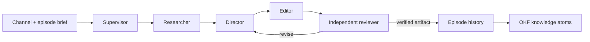

# Production harness

FrameForge uses a supervisor-led pipeline with independent review. Editable file-based roles live in `.claude/agents/`; production consumers first resolve `harness/manifest.json` and read the selected immutable bundle. Codex, jeo and jeopi can read the same contracts through the root `AGENTS.md`. These files define reusable work contracts. They do not prove that every runtime or external provider is connected. See [versioning and rollback](harness-versioning.md).

## Roles and handoffs

| Role | Owns | Required output |
|---|---|---|
| Supervisor | Scope, dependencies, version conflict resolution | Run manifest and summary |
| Researcher | Trend and creator evidence | Source URL, observed time, claim, uncertainty, visual reference notes |
| Director | Original treatment and editable template | Scenes, durations, layout, narration and source bindings |
| Editor | Validated scene changes and local render | New episode version, render receipt and artifact hash |
| Reviewer | Independent content and technical acceptance | Pass/fail findings tied to exact version and artifact |

Each run uses an absolute `<repo>/_workspace/<run-id>/` path resolved by the supervisor. Inputs include `channelId`, `episodeId`, `expectedVersion`, requested format, scope and available source IDs. Preserve `tasks.json`, per-role outputs, `conflicts.md` when needed and `run-summary.md`. These operational files may contain personal information; keep them out of public Git history.

Research can fan out by source only when each agent has a separate output path. Direction depends on completed research; editing depends on direction; review depends on the exact rendered candidate. An editor cannot approve its own render. On conflict, re-read the episode version and merge deliberately; never overwrite a newer version. On a timeout, report the existing job ID before considering a retry. Missing factual, rights or final-render evidence prevents a verified completion claim.

## Runtime boundary

The web chat submits bounded requests through `server/integrations.mjs` to the host bridge. The service validates patches before updating SQLite history. A CLI executable on PATH is availability evidence only; provider authentication and a successful invocation are separate checks. The built-in studio assistant is a deterministic helper, not an LLM. Publishing and channel creation remain separate authenticated platform operations.

## Durable memory

- `llm-wiki/index.md`: human-readable project knowledge; immutable source excerpts under `raw/` and OKF v0.1 atoms under `wiki/`.
- `.mex/ROUTER.md`: task-specific code context, populated architecture notes and a real CLI graph/check receipt.
- `.graphify/GRAPH_REPORT.md`: structural graph provenance and limitations; `.graphify/graph.html` is a navigable export.
- Application data has its own episode history and generated knowledge export. Build-time code graphs are not the live channel database.

Run the validation commands recorded in `.mex/verification.json` and `.graphify/verification.json` after source changes. Review whether a claim has become stale, not only whether a link still exists. Never store tokens, signed media URLs, browser storage or private source footage in these tracked knowledge layers.

## Acceptance scenarios

1. A sourced information episode retains each factual claim's source and observation time through edits.
2. A fictional drama episode labels fiction and keeps original scene direction separate from creator references.
3. Two editors start from the same version: the second stale write is rejected and reconciled.
4. A failed render stays failed in history and is never described as published.
5. A reviewer can trace the exact output hash to the episode version and input sources.

These are harness contracts. Runtime tests and verification receipts establish which scenarios have actually been exercised.
