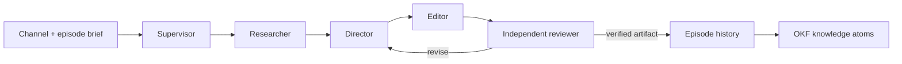

# Production harness

FrameForge uses a supervisor-led pipeline with independent review. Editable file-based roles live in `.claude/agents/`; production consumers first resolve `harness/manifest.json` and read the selected immutable bundle. Codex, jeo and jeopi can read the same contracts through the root `AGENTS.md`. These files define reusable work contracts. They do not prove that every runtime or external provider is connected. See [versioning and rollback](harness-versioning.md).

## Roles and handoffs

| Role | Owns | Required output |
|---|---|---|
| Supervisor | Scope, dependencies, version conflict resolution | Run manifest and summary |
| Researcher | Trend and creator evidence | Source URL, observed time, claim, uncertainty, visual reference notes |
| Director | Original treatment and editable template | Scenes, durations, layout, narration and source bindings |
| Editor | Validated scene changes and local render | New episode version, render receipt and artifact hash |
| Reviewer | Independent content and technical acceptance | Pass/fail findings tied to exact version and artifact |

Each run uses an absolute `<repo>/_workspace/<run-id>/` path resolved by the supervisor. Inputs include `channelId`, `episodeId`, `expectedVersion`, requested format, scope and available source IDs. Preserve `tasks.json`, per-role outputs, `conflicts.md` when needed and `run-summary.md`. These operational files may contain personal information; keep them out of public Git history.

Research can fan out by source only when each agent has a separate output path. Direction depends on completed research; editing depends on direction; review depends on the exact rendered candidate. An editor cannot approve its own render. On conflict, re-read the episode version and merge deliberately; never overwrite a newer version. On a timeout, report the existing job ID before considering a retry. Missing factual, rights or final-render evidence prevents a verified completion claim.

## Runtime boundary

The web chat submits bounded requests through `server/integrations.mjs` to the host bridge. The service validates patches before updating SQLite history. A CLI executable on PATH is availability evidence only; provider authentication and a successful invocation are separate checks. The built-in studio assistant is a deterministic helper, not an LLM. Publishing and channel creation remain separate authenticated platform operations.

## Executable production graph

`server/workflows.mjs` implements a bounded typed DAG for the visual node workspace. It has six stage types: `trend`, `research`, `script`, `storyboard`, `render` and `review`. Script, storyboard, render and review are required; trend and research are optional. Each stage type appears at most once. The current engine accepts 4–6 nodes and 3–15 forward edges, requires all nodes to reach the review output and rejects cycles, duplicate IDs, disconnected stages and invalid configuration. This is FrameForge's production graph, not a loader for arbitrary ComfyUI model workflows.

| Stage | Actual responsibility |
|---|---|
| Trend | Fetch source-backed keyword observations; empty results fail the node |
| Research | Gather saved references belonging to the episode channel and upstream outputs |
| Script | Invoke a configured agent, use the deterministic `studio` helper, or preserve authored scenes/audio with `existing` |
| Storyboard | Validate scenes and write a version-bound episode update |
| Render | Execute the local rendering adapter and retain its result |
| Review | Produce an `awaiting_review` checkpoint; persist a subsequent owner decision against the exact version, job and SHA-256 |

Each execution saves a workflow/version snapshot, episode/version snapshot and per-node states and outputs. The implementation orders validated dependencies deterministically. It allows at most four active runs and one active workflow per episode. A server restart marks interrupted runs failed. Cancellation prevents later stages; an already-running provider or render process may finish. The review node does not perform human visual review or publish to a channel. The independent reviewer role or owner must inspect the candidate afterward.

The file-based harness defines responsibilities around this executable graph. Graph nodes do not automatically launch every specialist role; agent selection is an explicit script-node configuration. Runtime API and end-to-end test receipts determine which graph paths have actually been exercised.

The authenticated service exposes `GET/POST /api/workflows`, `PUT /api/workflows/:id` with `expectedVersion`, `POST /api/workflows/:id/run` with `episodeId`, `GET /api/workflows/:id/runs`, `GET /api/workflows/:id/history`, `POST /api/workflows/:id/runs/:runId/cancel` and `POST /api/workflows/:id/runs/:runId/review`. A node is `{id,type,x,y,config}` and an edge is `{id,source,target}`. Only the script node currently accepts configuration: `{agent,prompt}`. Its agents are `existing`, `studio`, `codex`, `jeo`, `jeopi` and `hermes`; `existing` is workflow-only. Runtime adapter implementations may evolve, so inspect the live route contract and current tests before adding a new node type.

## Saved editing and native narration

Use the workflow script agent `existing` for a rerender of authored scenes. It validates and preserves the saved episode snapshot, including captions, layout, durations, trim offsets, narration text, audio URLs and volume. The storyboard stage still creates a new versioned snapshot. Generative script modes may replace scenes and therefore are unsuitable for a preservation-only rerender. Trend and research stages remain optional when rendering already prepared material.

`GET /api/speech/voices` reports the selected provider's current availability and installed Windows SAPI voices. A Windows service can synthesize locally. Linux Docker uses `SPEECH_PROVIDER=host-bridge` to reach the token-authenticated Windows bridge; the Linux image does not contain SAPI. Select an available voice rather than assuming a named voice exists on every machine. A configured endpoint alone does not prove availability: check connectivity, credentials and the returned voice list. Uploaded audio remains usable on either platform.

The bridge accepts only bounded `{text,voice,rate}` input and returns raw `audio/wav` bytes. Requests cannot choose host input/output paths. The container enforces a 50 MiB response limit, WAV signature and probed duration before attaching generated audio to its own data directory. Authentication, unavailable voices, busy synthesis, invalid audio and timeouts produce explicit failures; they never become successful narration jobs. Compose uses `HOST_AGENT_BRIDGE_URL` for its bridge override so a Windows-only loopback URL in the host's `.env` cannot silently replace the container route.

After saving the draft, submit `POST /api/episodes/:id/narration` with `{voice,expectedVersion,sceneIds?,rate?}`. The selected scenes use their `narration` text, falling back to scene `text`. The persisted job appears in `narrationJobs`; completion records its `resultVersion` and audio URLs. Generated WAV metadata, selected scene audio attachments, draft status, duration extensions and one episode-history snapshot commit atomically. A concurrent episode edit rejects the stale attachment and removes uncommitted generated files. A server restart marks interrupted jobs failed. Reload the resulting version and inspect the audio before running an `existing` workflow.

## Exact-candidate review

The review checkpoint alone is not acceptance. After inspecting the rendered video and audio, the authenticated owner or explicitly authorized supervisor submits `{decision:'approved'|'changes_requested',notes,expectedEpisodeVersion}` to `/api/workflows/:id/runs/:runId/review`. The read-only reviewer role supplies findings through the supervisor; it does not mutate the candidate or silently provide owner approval.

The service accepts a decision only for an unreviewed `awaiting_review` run whose rendered version equals both the submitted version and the current episode version. It checks the completed render job, safely reads the contained export and verifies its SHA-256. Older completed renders without a stored hash receive a computed hash during verification. Missing, changed or mismatched artifacts fail review. Version/status/job checks are repeated in the SQLite transaction before the decision, audit record and event are committed.

The run and review node become `approved` or `changes_requested`. `run.review` retains decision, notes, reviewed time, workflow/run identity, exact episode version, job ID, output URL and SHA-256. One decision is allowed per run. Later edits require a new render/run and review; the old receipt remains historical evidence. No review decision uploads or publishes content.

The 2026-10-18 `artifacts/production-smoke.json` receipt records an actual installed Korean SAPI voice, a 1080×1920 H.264/AAC output lasting 4.821333 seconds, mean volume −24 dB, preserved saved editing and a persisted hash-bound review on Windows. `artifacts/docker-production-smoke.json` separately records the staged Linux container using the authenticated host speech bridge: 1080×1920, 4.821333 seconds, mean volume −24.1 dB and a persisted exact-output review. `artifacts/local-container-smoke.json` verifies container render/review persistence after restart. These automated decisions test storage and binding; they are not owner acceptance, creative-quality judgments, publication or proof of production URL cutover.

## Container migration and recovery

Keep the original service data and history intact. `scripts/snapshot-data.mjs` opens SQLite read-only and uses SQLite backup or `VACUUM INTO` to capture committed state consistently, including WAL contents. It never constructs the application Store. Select an explicit snapshot root and an entirely new destination outside the live data directory. The utility copies referenced uploads/exports, verifies hashes and writes a completion marker only after integrity checks succeed. Its manifest retains entity IDs, episode/workflow versions, history/review counts and database/media hashes. Missing historical media or hash discrepancies fail the snapshot; do not silently discard those records.

Import with `scripts/import-snapshot.mjs` from a read-only snapshot mount into an existing empty dedicated data volume. The importer verifies the completion marker, plain-file paths, all declared hashes and database integrity, counts, IDs, versions and media references. It refuses overwrites and applies explicit UID/GID ownership when requested for the non-root service. Failure preserves partial output for diagnosis; use another empty volume after resolving the cause. Never reset the live database, prune unrelated volumes or delete the original data as a migration shortcut.

Before switching the production URL, compare imported IDs and versions with the snapshot, inspect episode/workflow histories and exact review/export hashes, exercise container speech and rendering, then restart the container and verify persisted state. A healthy Docker engine, a successful import or a staging smoke test alone is insufficient cutover evidence. Retain the original data and routing recovery path until the new service is verified through its actual URL. Record source snapshot identity, target volume, commands and results without credentials or private media.

## Durable memory

- `llm-wiki/index.md`: human-readable project knowledge; immutable source excerpts under `raw/` and OKF v0.1 atoms under `wiki/`.
- `.mex/ROUTER.md`: task-specific code context, populated architecture notes and a real CLI graph/check receipt.
- `.graphify/GRAPH_REPORT.md`: structural graph provenance and limitations; `.graphify/graph.html` is a navigable export.
- Application data has its own episode history and generated knowledge export. Build-time code graphs are not the live channel database.

Run the validation commands recorded in `.mex/verification.json` and `.graphify/verification.json` after source changes. Review whether a claim has become stale, not only whether a link still exists. Never store tokens, signed media URLs, browser storage or private source footage in these tracked knowledge layers.

## Acceptance scenarios

1. A sourced information episode retains each factual claim's source and observation time through edits.
2. A fictional drama episode labels fiction and keeps original scene direction separate from creator references.
3. Two editors start from the same version: the second stale write is rejected and reconciled.
4. A failed render stays failed in history and is never described as published.
5. A reviewer can trace the exact output hash to the episode version and input sources.
6. Narration generation either attaches all selected scene audio at the expected version or leaves the draft unchanged.
7. An `existing` rerender preserves authored scene/audio edits, and a stale or duplicate review cannot approve a different candidate.
8. Container narration returns verified WAV bytes from an authenticated available host voice or records an explicit failure without attaching partial audio.
9. A snapshot/import migration preserves exact identities, versions, history and reviewed media hashes; nonempty targets and invalid snapshots are rejected, and restart verification precedes a cutover claim.

These are harness contracts. Runtime tests and verification receipts establish which scenarios have actually been exercised.
