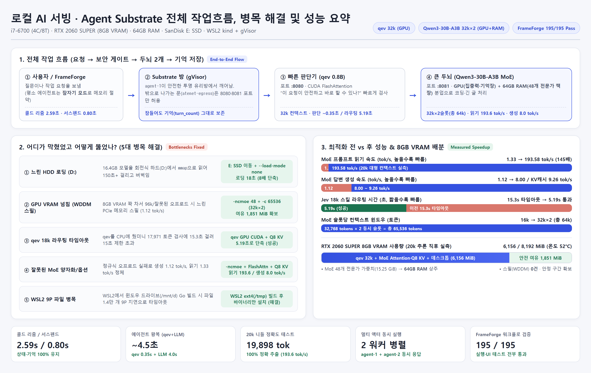

# Local AI Serving · Agent Substrate · SubstraOps Harness

FrameForge Studio 및 로컬 코딩 에이전트(`jeo-code`, `jeopi`, `agent-substrate`)를 로컬 PC(CPU + GPU 하이브리드)에서 서빙·관제·제어하기 위한 재현 가능한 하네스 패키지입니다.



## 아키텍처 구성

- **`scripts/start-qev-server.cmd`**: `qev-0.8b` (`:8080`, `/v1/systemone`, CUDA, `32k` 슬롯, `--metrics`)
- **`scripts/start-llm-server.cmd`**: `Qwen3.8-35B-A3B-Q4_K_M` (`:8081`, `/v1/chat/completions`, `-ngl 99 -ncmoe 38 -fa on -ctk q8_0 -ctv q8_0 -c 65536 -np 1 --load-mode none --reasoning off --metrics`)
- **`agent/` & `manifests/`**: `agent-substrate` (`kind` + `gVisor` `WorkerPool`, `ActorTemplate`, Zero-Trust `EgressPolicy` → `host.docker.internal:8080,8081`만 허용)
- **`dashboard/`**: SubstraOps 실시간 관제(SSE)·동적 SVG 토폴로지·병목 진단·CRUD 제어 대시보드 (`http://127.0.0.1:8095` / Tailscale Serve `:8443`)
- **`messenger-templates/`**: `jeo-code` 및 `jeopi` Discord 쓰레드별 로컬 모델 라우팅 템플릿 (시크릿 제외)

## 실측 기준 성능 (i7-6700 / RTX 2060 SUPER 8GB / 64GB RAM / E: SSD)

- `qev` (`:8080`, 32k): `jev route-skills` (17,971 tok) **5.19s**, `jev review` **0.33~0.70s**
- `Qwen3.8-35B-A3B` (`:8081`, 64k 단일 슬롯): 프리필 **128.2 tok/s**, 생성 **13.45 tok/s**, 19.8k 니들 추론 후 잔여 VRAM **2,063 MiB**
- `agent-substrate`: Cold Resume **2.59s**, Suspend **0.80s**, 메모리 스냅샷 상태 보존 확인

## 빠른 실행

```powershell
# 1) 호스트 추론 서버 시작
E:\llama-cpp-cuda\start-qev-server.cmd
E:\llama-cpp-cuda\start-llm-server.cmd

# 2) SubstraOps 대시보드 시작 및 Tailscale HTTPS 노출
node harness/local-ai-substrate/dashboard/server.mjs
tailscale serve --bg --https=8443 http://127.0.0.1:8095
```
